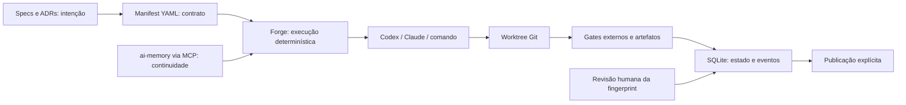

<p align="center"></p>

# Illumitech Forge

**Do contrato à evidência.** CLI em Rust para coordenar releases com Codex e Claude Code,
sem confundir a resposta de um agente com trabalho verificado.
**Candidata v0.2.0 validada: daemon opt-in, draft PR e importação Spec Kit.**
Codex é o cliente validado; Claude permanece experimental. [Escopo aprovado](docs/adr/0001-first-delivery-scope.md).

[English](README.en.md) · [Contratos](docs/contracts.md) · [Evidências atuais](docs/verification-v0.2.0.md) · [Specs](specs)


Privado inicialmente, licenciado sob **MIT** desde a primeira versão. O código está preparado
para uma abertura pública futura, por decisão explícita. A [v0.1.0](https://github.com/TheZehel/illumitech-forge/releases/tag/v0.1.0) foi publicada após aceite humano.
A [paridade operacional](docs/operational-parity.md) da próxima entrega tem evidências separadas.

## Instalação

Use o arquivo da sua plataforma na release privada: o binário não exige Rust.
O [guia de primeira execução](docs/quickstart.md) inclui verificação de checksums e exemplos
com e sem Codex. Git e Python 3 são necessários para os exemplos.

Para compilar do código-fonte, requer macOS ARM64 ou Linux x86_64, Git e Rust 1.94.0.
O binário Linux da CI requer glibc 2.39 ou superior (Ubuntu 24.04); outras distribuições podem compilar do código-fonte. Windows ainda não tem
suporte operacional. Codex e Claude Code são instalados e autenticados separadamente.

```sh
cargo build --release --locked
./target/release/illumitech-forge --help
./target/release/illumitech-forge doctor
```

Não há publicação no crates.io nesta etapa. Os arquivos de uma release privada devem incluir
binários das duas plataformas, `SHA256SUMS`, MIT e avisos de terceiros.

## Início rápido

O exemplo cria um repositório descartável, um avaliador externo e um manifest, sem chamar LLMs:

```sh
python3 scripts/demo.py /tmp/forge-demo
./target/release/illumitech-forge --state-dir /tmp/forge-demo/state release inspect /tmp/forge-demo/release.yaml
./target/release/illumitech-forge --state-dir /tmp/forge-demo/state release run /tmp/forge-demo/release.yaml --dry-run
./target/release/illumitech-forge --state-dir /tmp/forge-demo/state release run /tmp/forge-demo/release.yaml
./target/release/illumitech-forge --state-dir /tmp/forge-demo/state report /tmp/forge-demo/release.yaml
```

`--json` produz um envelope com `schema_version: 1`. Erros e bloqueios retornam código 2.
Sem `--json`, a primeira versão mostra o mesmo contrato com indentação para leitura humana.
`inspect`, `doctor`, `status`, `report`, `spec check`, `tools list/doctor/plan` e dry-run
não criam estado de execução. Consultas de memória utilizam apenas ferramentas MCP de leitura.

## Arquitetura



| Crate | Responsabilidade |
| --- | --- |
| `forge-domain` | Manifest, DAG, fingerprints, locks, SQLite e aceites |
| `forge-adapters` | Processos, clientes nativos e MCP |
| `forge-catalog` | Receitas seletivas e configuração idempotente |
| `forge-cli` | Comandos, controle de execução e publicação |

SQLite e avaliadores devem ficar **fora dos repositórios graváveis pelos executores**.
Um lock do sistema operacional por worktree coordena diferentes instâncias. O Forge é um
orquestrador local confiável; não substitui isolamento do sistema operacional contra um usuário malicioso.

## Ciclo de trabalho

1. Escreva `spec.md`, `plan.md` e `tasks.md` com IDs permanentes.
2. Defina repositórios, tarefas, executores, dependências, limites e aceites no manifest v1.
3. Revise `release inspect` e `release run --dry-run`, incluindo permissões e comandos.
4. Execute `release run`. Use `pause`, `resume`, `cancel`, `status` e `report` para controle.
5. Gates verificam comandos e arquivos; artefatos exigem SHA-256; revisão humana usa `release approve`.
6. Execute `release publish` separadamente quando todos os requisitos estiverem satisfeitos.

Pausa vale na fronteira da execução atual; cancelamento envia TERM ao grupo e KILL após o prazo.
Defaults: 30 minutos por tarefa, 10 por gate e três tentativas totais de execução. Falhas de
contrato, spawn, resultado estruturado, permissão e memória obrigatória não recebem retry automático.
Aprovações exigem a fingerprint avaliada e são invalidadas por mudanças materiais. Após crash
ou mudança externa, `resume --reconcile 'motivo'` invalida os aceites e reinicia a avaliação;
processos órfãos vivos precisam ser investigados antes da reconciliação.

## Memória e clientes

Configure `memory.endpoint`, `workspace` e o mapeamento explícito de cada repo para seu projeto.
O endpoint MCP usa HTTPS, exceto loopback. Tokens são referências a variáveis de ambiente,
nunca valores no manifest. `memory doctor` verifica a capacidade e o escopo devolvido pelo servidor;
`memory query` recupera até cinco fontes com trechos limitados.

`required: true` bloqueia execução quando memória ou escopo não podem ser comprovados.
Sem configuração de memória, o Forge executa e publica normalmente. Modo opcional registra degradação. O Forge não acessa o banco do ai-memory, não escreve páginas
permanentes e não instala hooks. As integrações nativas existentes continuam responsáveis pela
captura; procedimentos compartilhados ficam em `skills/core/SKILL.md`.
No ai-memory 3.2.9, desative o backfill automático no cliente nativo para que ele não
importe a sessão em andamento junto com os hooks. Veja o [guia](docs/quickstart.md#memória-e-limites--memory-and-limits).

Os adaptadores preservam autenticação, configuração e modelo padrão dos CLIs. Um modelo só
é passado quando declarado no manifest. Codex usa sandbox explícito; Claude usa `dontAsk`
e respeita as permissões já concedidas. Para escrita com Claude, conceda regras `Edit` limitadas
ao projeto antes da execução. Um bloqueio não aciona fallback para uma API paga.

## Toolkit

```sh
illumitech-forge tools list
illumitech-forge tools plan rust security
illumitech-forge tools apply rust security
```

A aplicação cria apenas as receitas selecionadas em `.forge-toolkit/`, sem executar instaladores
remotos. Uma segunda aplicação preserva conteúdo igual; divergências bloqueiam sem sobrescrever.
O catálogo distingue receita disponível, configuração local instalada, executável descoberto e
teste funcional. Revisões upstream não verificadas permanecem explícitas. Perfis Rust, Node/TypeScript
e genérico preservam a stack do projeto. RTK e Graphify são pilotos; estilos como Superpowers,
Ponytail e Caveman são opcionais. Não existe limite universal de linhas por arquivo.

## Qualidade, exemplos e adoção

```sh
cargo fmt --check
cargo clippy --workspace --all-targets --locked -- -D warnings
cargo test --workspace --locked
cargo doc --workspace --no-deps --locked
python3 scripts/licenses.py
```

Os testes cobrem falso aceite textual, alteração de revisão, escopo obrigatório indisponível,
locks, cancelamento, timeout, saída excessiva, pausa/retomada e setup repetido. Consulte o
[ledger](docs/verification-v0.2.0.md) para separar testes locais, clientes reais e CI.
`eval run` executa manifests de fixtures com o mesmo motor e os mesmos gates.

`release import-loop` gera um candidato revisável. Estados antigos nunca viram evidência atual;
tarefas pendentes do Spec Kit são expandidas com IDs estáveis e gates exigem conversão revisada.
`release import-spec` gera candidatos diretamente de specs. O Loop Python continua
operacional e a migração é gradual. [Procedimento de atualização ai-memory](docs/memory-upgrade.md).

## Roadmap e créditos

As [13 specs](specs) rastreiam fundação, contratos, recuperação, execução, evidências, memória,
catálogo, avaliações, legado, atualização da memória, distribuição e aceitação integrada.
O daemon opt-in supervisiona a fila em primeiro plano; `daemon-control` pausa e retoma a fila.
O contrato pode habilitar commit e draft PR, sempre em worktree isolado com identidade humana,
reavaliação após commit e recuperação sem duplicação. Nenhum merge ou release é automático.
Veja o [guia de operação e limites de adoção](docs/operational-parity.md).
Dashboard web, runtime nativo da memória e abertura pública permanecem no roadmap.

Illumitech · MIT. Créditos e licenças de terceiros em [THIRD_PARTY_NOTICES](THIRD_PARTY_NOTICES).
Inspirado no ciclo determinístico do Loop Engineering e em avaliações controladas de agentes.
Nenhum benchmark pago ou framework oficial Harness² é incluído. Não há badges de desempenho não medido.

Windows 11 x86_64 / PowerShell 7 tem uma implementação candidata, CI nativa e ZIP preparados para a próxima entrega. A execução nativa e o piloto autenticado permanecem pendentes; a v0.2.0 publicada não muda. Consulte o [inventário e gates Windows](docs/windows-portability.md).
