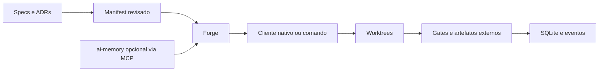

<p align="center"></p>

# Illumitech Forge

**Do contrato à evidência.** Organize uma demanda em specs e tarefas, execute com o cliente
nativo e acompanhe resultados verificáveis no CLI ou no Workbench Illumitech.

**Illumitech Forge 1.8.0.** Publicação recuperável de releases, instalação verificada da skill por projeto e continuidade com evidências. O CLI e o Workbench continuam independentes da skill. Veja as [notas desta versão](docs/release-v1.8.0.md), o [guia da skill](docs/skill-getting-started.md) e o [guia de recuperação](docs/release-recovery.md). Artefatos e checksums ficam nas [releases](https://github.com/TheZehel/illumitech-forge/releases); compilar este código não atualiza um binário já instalado.

[English](README.en.md) · [Começar](docs/quickstart.md) · [Contratos](docs/contracts.md) · [Roadmap](docs/roadmap-v1.md)


A série **1.1** oferece o comando Rust nativo `forge` e uma experiência de terminal
com identidade ASCII, Markdown, ajuda, menu de comandos e histórico pesquisável.
As notas e a cobertura ficam em [release 1.2.0](docs/release-v1.2.0.md).

## O que está implementado

- [Módulos de desenvolvimento](docs/development-modules.md): feature com preparação, execução, validação por tarefa e retomada; QA leve, padrão ou intensivo com comandos revisados e cobertura observada.
- Estimativas locais de trabalho ativo, com faixa, confiança, histórico e comparação com o realizado.
- Medição de tokens, contexto seletivo e limites de tempo, tentativas e concorrência.
- Workbench local: conta gerenciada do Codex, conversas, streaming, decisões, retomada e evidências.
- Criação guiada, proposta estruturada de specs/DAG, templates versionados e deltas de escopo.
- Controles de execução e aceite humano por revisão; cache opt-in com invalidação conservadora.
- Tarefas paralelas em worktrees existentes, um escritor por raiz, e revisão nativa independente.
- Issue selecionada → candidato revisável → execução → draft PR sob autorização explícita.
- Diagnóstico de PATH, atualização local verificada, snapshots SQLite consistentes e restauração.

Claude permanece experimental e fora do aceite nativo desta entrega. A conversa livre usa
somente leitura; a implementação usa um manifest revisado. A resposta do chat não aprova gates.

## Começar com a versão publicada

```sh
cargo install illumitech-forge-cli --version 1.8.0 --locked
forge --version
forge
```

Execute `forge` dentro de um projeto Git existente. Instale e autentique o Codex CLI
separadamente para conversar; conta, modelo e permissões continuam nativos. Não é necessário
rodar `init`, configurar memória, instalar Python ou Node para abrir a interface. A conversa
livre é somente leitura; executar uma implementação exige um manifest revisado.

Cargo requer Rust 1.94.0. O [pacote binário macOS ARM64 da release pública](https://github.com/TheZehel/illumitech-forge/releases/tag/v1.8.0)
dispensa Rust. O repositório GitHub e o código dos crates são públicos sob MIT.
[Início rápido](docs/quickstart.md): instalação, verificação de versão, PATH e Workbench.

## Workflows integrados na 1.2.0

Workflows conectam pedido, escopo aprovado, verificações e execução no terminal e no Workbench.
Novos comandos `workflow prepare|start|status|resume`, `/plan`, `/run`, `/tasks`, `/report`,
importação SARIF e comparação por entrega aceita. [Guia](docs/guides/workflows.pt.md) ·
[Economia](docs/guides/economy.pt.md) · [Implementação e limites](docs/growth-candidate.md).
Site PT/EN é uma prévia local sem domínio ou telemetria, alinhada à identidade oficial do Figma. O repositório GitHub é público desde 02/11/2026.
Esta seção descreve implementação; o aceite da fonte final pertence ao ledger externo.

## Base de primeira experiência

- `forge demo create DIRECTORY`: demonstração nativa com comando, gate externo e estado,
  sem agente, conta ou Python. Veja o [passo a passo](docs/quickstart.md#demonstracao-sem-agente).
- `init` cria roteamento de memória somente com `--memory-workspace ID`; configurações
  existentes são preservadas. Não é necessário executar `init` para conversar.
- `installation doctor` inspeciona os dois nomes no PATH sem executar candidatos desconhecidos.
- `status` e `report` retornam 2 quando evidências ficam obsoletas, mesmo com snapshot histórico
  `passed`. A documentação de instalação e suporte foi alinhada à distribuição real.

Para desenvolver: `cargo build --locked -p illumitech-forge-cli --bins`. Os assets web vêm
embutidos; desenvolvimento da UI usa Node 24 LTS e `npm ci --prefix apps/forge-ui --ignore-scripts`.
Compilar não substitui executáveis instalados nem altera seu PATH.

## Ciclo de trabalho

Pedido → specs → proposta validada → inspect/dry-run → execução → gates → revisão humana,
quando declarada. Propostas são candidatas sem autorização de executar ou publicar. Mantenha
manifests, avaliadores fixados por hash e SQLite fora do diretório gravável pelo agente.



Specs/ADRs expressam intenção; manifests são contratos; SQLite guarda o estado operacional;
Git guarda código. ai-memory oferece continuidade por MCP e **não é obrigatório**. O modo
`required: true` só deve ser escolhido quando o projeto realmente exigir memória verificável.
Skills especializadas complementam o motor. O Loop legado continua disponível para migração gradual.

## Limites e qualidade

As métricas cobrem as chamadas registradas pelo Forge, não toda a conta. Cache de entrada é
parte da entrada; ausência de uso permanece desconhecida. Uma chamada nativa pode fazer várias
requisições ao provedor. Hooks, MCPs e outras sessões preservam suas configurações e podem ter
atividade fora desse registro. Não há promessa de economia percentual, preço ou prazo.

O cache exige observação conservadora dos insumos. Árvores com symlinks em `node_modules` ou
builds além do limite observado provocam miss e nova validação. Não foi demonstrada economia
pelo cache na própria execução deste programa. [Medições e limites](docs/v1-candidate.md).

macOS tem pilotos nativos em checkpoints anteriores; o aceite da revisão final fica no ledger
externo. Linux ARM64 tem baseline local em VM/contêiner; o sandbox nativo da conta foi bloqueado
nesse laboratório. Windows/PowerShell permanece experimental, sem piloto nativo. Não se presume
paridade entre mocks, execução em VM e conta nativa. [Matriz](docs/v1-candidate.md#plataformas).

CI, publicação, merge, mudança de visibilidade, instalação global e ativação de serviços são
operações separadas. `budget.actions: off` bloqueia escritas remotas que possam ativar CI;
`[skip ci]` não é garantia de ausência de Actions. O programa de implementação usa checks locais.

## Documentação e créditos

[Workbench](docs/workbench.md) · [Economia](docs/token-economy.md) · [Duração](docs/duration-estimates.md) ·
[Templates/orçamentos/cache](docs/m06-operating-contracts.md) · [Paralelismo/revisão](docs/m07-operating-contracts.md) ·
[Issue/PR](docs/m08-operating-contracts.md) · [Atualização/recuperação](docs/m09-operating-contracts.md) ·
[Serviços opt-in](docs/user-services.md) · [Distribuição](docs/public-distribution.md)

Copyright Illumitech. Licença [MIT](LICENSE). Avisos de dependências em
[THIRD_PARTY_NOTICES](THIRD_PARTY_NOTICES), inventário em [docs/dependencies.json](docs/dependencies.json)
e origem dos ativos em [provenance.json](docs/assets/provenance.json). Commits e publicações usam
identidade humana configurada, sem atribuição de autoria a agentes.


## Diagnóstico, continuidade e skill — 1.7.0

A versão 1.7.0 reúne diagnóstico da primeira execução, descoberta de comandos, explicações
operacionais e continuidade compartilhada entre CLI, Workbench e uma skill portátil.
[Instalação, contratos e limites dos pilotos](docs/agent-experience.md) ·
[Tutorial da skill e feedback voluntário](docs/skill-getting-started.md) ·
[Notas da versão](docs/release-v1.7.0.md).
O Codex executa os agentes. A skill foi descoberta no Codex CLI e na extensão Codex dos
editores VS Code e Cursor. Uma Feature pequena passou em cada editor, com gates externos
e preservação conferida. Instalação por diretório e outros fluxos precisam de evidências próprias.

## Distribuição e recuperação na 1.8.0

O instalador `scripts/install_agent_skill.py` acompanha o pacote binário, verifica o ZIP
standalone e o CLI selecionado e faz prévia sem escrever. `--apply` instala uma cópia por
projeto, preservando instalações existentes. Codex CLI e sua extensão no VS Code/Cursor
usam `--host codex`; `--host cursor` seleciona o carregador do Cursor Agent.

A recuperação de `release publish` exige `contracts.release_publication=1`, evidência
atual e aprovação humana da revisão. Reconcilia o provedor, verifica bytes e reutiliza
ativos válidos; resultados incertos e conflitos não autorizam sobrescrita. O formulário
de feedback é voluntário e não envia dados automaticamente. Os pilotos históricos
continuam vinculados às versões avaliadas; não são novo aceite desta versão em IDEs.
